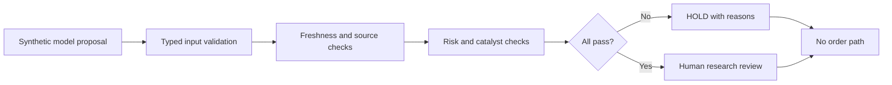

# Examples

Two examples written for this public repository, separate from the private system's code. Both
run on synthetic inputs with Python 3.11 or newer and only the standard library. Neither
connects to a broker, a market-data source, a model API or a user account.

- [The research review gate](#the-research-review-gate): `fail_closed_gate.py`
- [Backtest-overfitting diagnostics](#backtest-overfitting-diagnostics): `backtest_diagnostics/`
  and `overfitting_demo.py`

The tests for both run with:

```bash
python3 -B -m unittest discover -s examples -p 'test_*.py' -v
```

## The research review gate

`fail_closed_gate.py` is an original, simplified stand-in for the private system's review gate.
A model's trade idea reaches human review only if every check passes. Anything missing, stale or
malformed returns `HOLD` with machine-readable reasons. Neither result authorizes a trade:
`order_authorized` and `broker_invoked` are always false.

```bash
python3 -B examples/fail_closed_gate.py --all
```

| Scenario | Result | What it tests |
| --- | --- | --- |
| `fresh` | `REVIEWABLE_RESEARCH` | Every check passes, and a person still reviews the idea |
| `stale-quote` | `HOLD` | The quote is older than the 5-minute freshness window |
| `single-source` | `HOLD` | Two independent sources are required |
| `over-budget` | `HOLD` | The hypothetical loss exceeds the synthetic risk budget |
| `bad-digest` | `HOLD` | A source digest has an invalid format |
| `narrative-pressure` | `HOLD` | Persuasive model text cannot override stale evidence |



Limits of the gate:

- The clock and candidate ID are fixed, so the demo is repeatable and cannot be fed a real
  ticker.
- Source digests are checked for format only. No source content is fetched or authenticated, so
  `source_receipts_authenticated` is always false.
- The volume, spread and reward-to-risk thresholds are toy values, not tested trading rules.
- There is no market calendar, transaction cost model, options support, broker permission check,
  live quote check or portfolio-level risk.

The scenarios are tested in [`test_fail_closed_gate.py`](test_fail_closed_gate.py), and the
[offline checks workflow](../.github/workflows/research-demo.yml) runs them on every push.

## Backtest-overfitting diagnostics

`backtest_diagnostics/` holds four diagnostics that quant reviewers apply before trusting a
backtest. It takes plain lists of per-period returns and is deterministic for a given seed. The
[main README](../README.md#result) shows the demo's result.

```bash
python3 -B examples/overfitting_demo.py                         # demo; exit 1 if a verdict is unexpected
python3 -B examples/overfitting_demo.py --null 400              # pass rates with no skill anywhere
python3 -B examples/overfitting_demo.py --null 400 --block 1    # the same with a mean bootstrap block of 1
python3 -B examples/overfitting_demo.py --power 400             # pass rates with an edge in strategy 0
python3 -B examples/overfitting_demo.py --psr 4000              # PSR on 4,000 strategies judged one at a time
```

| Module | What it computes |
| --- | --- |
| `sharpe.py` | Per-period Sharpe ratio, skewness and kurtosis; PSR, DSR, the expected maximum Sharpe ratio of N no-skill trials, and the minimum track record length |
| `cscv.py` | Probability of backtest overfitting by combinatorially symmetric cross-validation |
| `reality_check.py` | Stationary-bootstrap resamples; White's Reality Check and Hansen's consistent SPA test from the same resamples |
| `synthetic.py`, `calibration.py` | No-skill and injected-skill return matrices; pass rates over many seeded universes |

### How each diagnostic works

- **PSR** (Bailey and López de Prado 2012) is
  Φ((SR − SR*) √(T − 1) / √(1 − γ3 SR + (γ4 − 1)/4 SR²)): the probability that the true Sharpe
  ratio exceeds SR*, given T returns with skewness γ3 and kurtosis γ4.
- **DSR** (Bailey and López de Prado 2014) is the PSR against SR0, the expected best Sharpe ratio
  of N no-skill trials: √V ((1 − γ) Φ⁻¹(1 − 1/N) + γ Φ⁻¹(1 − 1/(N e))), where V is the variance of
  the trials' Sharpe ratios and γ is the Euler-Mascheroni constant.
- **PBO** (Bailey, Borwein, López de Prado and Zhu 2017) splits the T × N return matrix into S
  equal blocks. For each of the C(S, S/2) ways to pick half of the blocks as in-sample, it takes
  the strategy with the best in-sample Sharpe ratio. Its out-of-sample rank r gives
  λ = ln(w / (1 − w)) with w = r / (N + 1). PBO is the share of splits with λ ≤ 0.
- **Reality Check** (White 2000) compares max over k of √T times the mean differential against
  the same maximum over stationary-bootstrap resamples (Politis and Romano 1994), centred at
  zero. **SPA** (Hansen 2005) studentizes each strategy by its bootstrap standard deviation and
  keeps clearly losing strategies at their own negative mean, so they cannot inflate the
  p-value.

### How it is checked

| What | Checked against | Result |
| --- | --- | --- |
| DSR and SR0 | The numerical example in Bailey and López de Prado (2014), inputs below | SR0 = 0.1132, DSR = 0.9004 |
| PSR | Its closed form for normal returns | Equal |
| Minimum track record length | The PSR it inverts | Equal to 12 decimals |
| Expected maximum Sharpe ratio | Simulated maxima of 10, 100 and 1,000 trials | Within 3% |
| PBO | A brute-force implementation (rebuilt matrices, sorting) on 18 matrix and block combinations, and a hand-checked example | Equal, and independent of strategy order |
| Bootstrap means from prefix sums | Means over the explicitly resampled rows | Equal |
| Reality Check, one strategy, block of 1 | A one-sided normal test | p-values within 0.01 |
| SPA and Reality Check, one skilled strategy plus 20 clearly losing ones | The skilled strategy alone | SPA p stays at 0.046; the Reality Check's rises from 0.046 to 0.384 |
| Block lengths | A huge mean block (1e17), and infinite or NaN lengths | One block; rejected |
| Error rates | Null simulations | PSR alone passes about 5%, no-skill PBO averages about 0.5, and the Reality Check and SPA reject at most 5% plus three standard errors |

The published DSR example has these inputs:

| Input | Value |
| --- | --- |
| Trials | 100 |
| Annualized Sharpe ratio of the best trial | 2.5 |
| Daily returns | 1,250 |
| Skewness and kurtosis | −3 and 10 |
| Annualized variance of the trials' Sharpe ratios | 0.5 |

The SPA row shows why the two tests differ: SPA keeps clearly losing strategies at their own
negative means, while the Reality Check centres every strategy at zero, so losers raise its
p-value. The demo test also requires every expected verdict.

Nine deliberate bugs each make at least one test fail: the DSR ignoring N, a sign error in the
PSR kurtosis term, E[max] without the γ mix, CSCV ranking from the best, CSCV picking the
in-sample loser, uncentred Reality Check resamples, blocks without wrap-around, a Reality Check
that ignores the search, and an SPA that centres every strategy at its own mean.

Outside CI, the DSR and PBO also agreed with the snapshot's own
[`scripts/quant/selection_bias.py`](../scripts/quant/selection_bias.py) to within 5e-11 on 20
synthetic matrices. That module needs private code, so the comparison cannot run here.

### Pass rates over 400 synthetic universes

Each universe has 20 strategies of 500 Student-t returns. Standard errors are at most 0.025.

| Diagnostic passes | No skill, block 10 | No skill, block 1 | Edge of 3.0 in strategy 0 |
| --- | --- | --- | --- |
| PSR ≥ 0.95, winner | 0.647 | 0.647 | 1.000 |
| DSR ≥ 0.95, winner | 0.000 | 0.000 | 0.463 |
| PBO ≤ 0.10 | 0.015 | 0.015 | 0.667 |
| Reality Check p < 0.05 | 0.045 | 0.050 | 0.900 |
| SPA p < 0.05 | 0.095 | 0.060 | 0.920 |
| Mean PBO | 0.506 | 0.506 | 0.089 |

Picking the winner raises the PSR's false-pass rate to 64.7%. Judged one at a time, 4,000
no-skill strategies pass 5.00% of the time (`--psr 4000`). The DSR, PBO and Reality Check bring
the winner's rate back to 5% or below.

SPA's 9.5% with a block of 10 is a property of the test, not noise. Rerunning with 999
resamples and normal returns gives the same rate. On independent data, a long block makes SPA's variance estimates
noisy and its studentized maximum too large. Choose the block length for the serial dependence
of the data.

### Limits

- The returns are independent Student-t draws. Real returns have autocorrelation, volatility
  clustering and regime changes, and no costs are modelled.
- The DSR treats the trials as independent and estimates V from them. Correlated variants mean
  fewer effective trials, which makes the DSR too strict. It is also a strict test of skill here:
  with an edge of 3.0, it passed only 46.3% of winners.
- PBO needs every variant that was tried, equal blocks that divide T, and a choice of S. The
  0.10 threshold in the demo is illustrative.
- The Reality Check and SPA test against a zero benchmark, are one-sided, and depend on the
  bootstrap block length. Their p-values move in steps of 1 / (B + 1).
- The code is pure Python. CSCV costs C(S, S/2) × N × S/2 operations, and the bootstrap costs
  B × N × T / (mean block) operations.
- The diagnostics can flag a lucky backtest. Passing them does not show that a strategy will be
  profitable.
