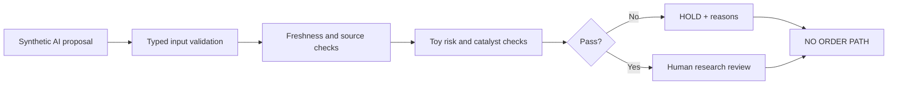

# Runnable offline example — deterministic research gate

**Teaching example only.** This is original, synthetic demonstration code for the public showcase, not a copy of or replacement for the private trading engine. It never connects to a brokerage, market-data source, model API or user account, and has no order path.

## Try it with Python 3.11+

```bash
python3 -B examples/fail_closed_gate.py --all
python3 -B -m unittest discover -s examples -p 'test_*.py' -v
```

One fictional clean scenario returns `REVIEWABLE_RESEARCH` (human review only). Five intentional failure scenarios return `HOLD` and machine-readable reasons. **Neither state authorizes trades**; `order_authorized` and `broker_invoked` are always false.

| Scenario | Expected | Tested boundary |
| --- | --- | --- |
| `fresh` | `REVIEWABLE_RESEARCH` | Illustrative checks pass, human review remains mandatory |
| `stale-quote` | `HOLD` | Input outside the toy 5-minute freshness window |
| `single-source` | `HOLD` | Two independent sources required |
| `over-budget` | `HOLD` | Hypothetical loss exceeds synthetic risk budget |
| `bad-digest` | `HOLD` | Invalid digest format |
| `narrative-pressure` | `HOLD` | AI-generated text cannot override stale evidence |



## Limitations and provenance

- The clock and candidate ID are fixed, so the demonstration is repeatable and cannot be fed a real ticker.
- Receipt digest values are validated **for format only**. No source content is fetched or independently authenticated (`source_receipts_authenticated=false`).
- Toy thresholds (synthetic $2M volume, 35 basis-point spread, 2:1 ratio) are not validated trading thresholds or actionable financial advice.
- A real market calendar, transaction costs, options, broker permissions, live quote verification and portfolio-level risks are intentionally not implemented.
- No real holdings, accounts, news, credentials, private runtime, logs or vendor data are embedded.

[Public architecture](../README.md) · [Automated checks](../.github/workflows/research-demo.yml) · [Review test cases](test_fail_closed_gate.py)
