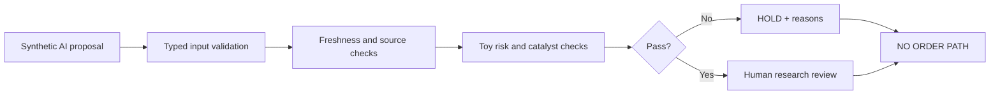

# Runnable offline example — deterministic research gate

**Teaching example only.** This is original, synthetic demonstration code for the public showcase, not a copy of or replacement for the private trading engine. It never connects to a brokerage, market-data source, model API or user account, and has no order path.

## Try it with Python 3.11+

```bash
python3 -B examples/fail_closed_gate.py --all
python3 -B -m unittest discover -s examples -p 'test_*.py' -v
```

One fictional clean scenario returns `REVIEWABLE_RESEARCH` (human review only). Five intentional failure scenarios return `HOLD` and machine-readable reasons. **Neither state authorizes trades**; `order_authorized` and `broker_invoked` are always false.

| Scenario | Expected | Tested boundary |
| --- | --- | --- |
| `fresh` | `REVIEWABLE_RESEARCH` | Illustrative checks pass, human review remains mandatory |
| `stale-quote` | `HOLD` | Input outside the toy 5-minute freshness window |
| `single-source` | `HOLD` | Two independent sources required |
| `over-budget` | `HOLD` | Hypothetical loss exceeds synthetic risk budget |
| `bad-digest` | `HOLD` | Invalid digest format |
| `narrative-pressure` | `HOLD` | AI-generated text cannot override stale evidence |



## Limitations and provenance

- The clock and candidate ID are fixed, so the demonstration is repeatable and cannot be fed a real ticker.
- Receipt digest values are validated **for format only**. No source content is fetched or independently authenticated (`source_receipts_authenticated=false`).
- Toy thresholds (synthetic $2M volume, 35 basis-point spread, 2:1 ratio) are not validated trading thresholds or actionable financial advice.
- A real market calendar, transaction costs, options, broker permissions, live quote verification and portfolio-level risks are intentionally not implemented.
- No real holdings, accounts, news, credentials, private runtime, logs or vendor data are embedded.

[Public architecture](../README.md) · [Automated checks](../.github/workflows/research-demo.yml) · [Review test cases](test_fail_closed_gate.py)

## Backtest-overfitting diagnostics

`backtest_diagnostics/` is a self-contained package of four diagnostics that quant reviewers
apply before trusting a backtest. It uses only the standard library, takes plain lists of
per-period returns, and is deterministic for a given seed. All data in the demo and the tests
are synthetic.

```bash
python3 -B examples/overfitting_demo.py                         # demo; exit 1 if a verdict is unexpected
python3 -B examples/overfitting_demo.py --null 400              # pass rates with no skill anywhere
python3 -B examples/overfitting_demo.py --null 400 --block 1    # the same with a mean bootstrap block of 1
python3 -B examples/overfitting_demo.py --power 400             # pass rates with an edge in strategy 0
python3 -B examples/overfitting_demo.py --psr 4000              # PSR on 4,000 strategies judged one at a time
```

| Module | What it computes |
| --- | --- |
| `sharpe.py` | Per-period Sharpe ratio, skewness and kurtosis; PSR, DSR, the expected maximum Sharpe ratio of N no-skill trials, and the minimum track record length |
| `cscv.py` | Probability of backtest overfitting by combinatorially symmetric cross-validation |
| `reality_check.py` | Stationary-bootstrap resamples; White's Reality Check and Hansen's consistent SPA test from the same resamples |
| `synthetic.py`, `calibration.py` | No-skill and injected-skill return matrices; pass rates over many seeded universes |

**How each works.**

- **PSR** (Bailey and López de Prado 2012) is
  Φ((SR − SR*) √(T − 1) / √(1 − γ3 SR + (γ4 − 1)/4 SR²)): the probability that the true Sharpe
  ratio exceeds SR*, given T returns with skewness γ3 and kurtosis γ4.
- **DSR** (Bailey and López de Prado 2014) is the PSR against SR0, the expected best Sharpe ratio
  of N no-skill trials: √V ((1 − γ) Φ⁻¹(1 − 1/N) + γ Φ⁻¹(1 − 1/(N e))), where V is the variance of
  the trials' Sharpe ratios and γ is the Euler-Mascheroni constant.
- **PBO** (Bailey, Borwein, López de Prado and Zhu 2017) splits the T × N return matrix into S
  equal blocks. For each of the C(S, S/2) ways to pick half of the blocks as in-sample, it takes
  the strategy with the best in-sample Sharpe ratio. Its out-of-sample rank r gives
  λ = ln(w / (1 − w)) with w = r / (N + 1). PBO is the share of splits with λ ≤ 0.
- **Reality Check** (White 2000) compares max over k of √T times the mean differential against
  the same maximum over stationary-bootstrap resamples (Politis and Romano 1994), centred at
  zero. **SPA** (Hansen 2005) studentizes each strategy by its bootstrap standard deviation and
  keeps clearly losing strategies at their own negative mean, so they cannot inflate the
  p-value.

**How it is checked** (`python3 -B -m unittest discover -s examples -p 'test_*.py' -v`):

- The DSR inputs of the numerical example in Bailey and López de Prado (2014) (100 trials, an
  annualized Sharpe ratio of 2.5 over 1,250 daily returns, skewness −3, kurtosis 10, an
  annualized trial variance of 0.5) give SR0 = 0.1132 and DSR = 0.9004.
- The PSR matches its closed form for normal returns, and the minimum track record length
  inverts it to 12 decimals. The expected maximum Sharpe ratio is within 3% of simulated maxima
  for 10, 100 and 1,000 trials.
- PBO matches a brute-force implementation (rebuilt matrices, sorting) on 18 matrix and block
  combinations. It also passes a hand-checked example and is independent of strategy order.
- Bootstrap means from prefix sums equal the means over the explicitly resampled rows. With
  one strategy and a block of 1, the Reality Check p-value is within 0.01 of a one-sided normal
  test.
- Null simulations check that a strategy judged alone passes PSR about 5% of the time, that
  no-skill PBO averages about 0.5, and that the Reality Check and SPA reject no more than 5%
  plus three standard errors. The demo test requires every expected verdict.
- Each of eight deliberate mutations makes at least one test fail. Mutated were the DSR ignoring
  N, a sign in the PSR kurtosis term, E[max] without the γ mix, CSCV ranking from the best, CSCV
  picking the in-sample loser, uncentred Reality Check resamples, blocks without wrap-around, and
  a Reality Check that ignores the search. In a scratch environment, the DSR and PBO also agreed
  to within 5e-11 with the snapshot's own `scripts/quant/selection_bias.py` on 20 synthetic
  matrices (that module needs private code, so this check is not in CI).

**Pass rates over 400 seeded synthetic universes** (20 strategies, 500 Student-t returns each;
standard errors are at most 0.025):

| Diagnostic passes | No skill, block 10 | No skill, block 1 | Edge of 3.0 in strategy 0 |
| --- | --- | --- | --- |
| PSR ≥ 0.95, winner | 0.647 | 0.647 | 1.000 |
| DSR ≥ 0.95, winner | 0.000 | 0.000 | 0.463 |
| PBO ≤ 0.10 | 0.015 | 0.015 | 0.667 |
| Reality Check p < 0.05 | 0.045 | 0.050 | 0.900 |
| SPA p < 0.05 | 0.095 | 0.060 | 0.920 |
| Mean PBO | 0.506 | 0.506 | 0.089 |

Picking the winner raises the PSR's false-pass rate from 5.00% for a strategy judged alone to
64.7%. The DSR, PBO and Reality Check bring it back to 5% or below. SPA's 9.5% with a block of 10
is a real property, not noise (999 resamples and normal returns give the same): on independent
data, a long block makes its variance estimates noisy and the studentized maximum too large.

**Limits.**

- The returns are independent Student-t draws. Real returns have autocorrelation, volatility
  clustering and regime changes, and no costs are modelled.
- The DSR treats the trials as independent and estimates V from them. Correlated variants mean
  fewer effective trials, which makes the DSR too strict. The DSR is also a strict test of skill
  here: it passed only 46.3% of winners with a 3.0 edge over two years.
- PBO needs every variant that was tried, equal blocks that divide T, and a choice of S; the 0.10
  threshold in the demo is illustrative. The Reality Check and SPA test against a zero benchmark,
  are one-sided, and depend on the bootstrap block length; their p-values move in steps of
  1 / (B + 1).
- The code is pure Python: CSCV costs C(S, S/2) × N × S/2 operations, and the bootstrap
  B × N × T / (mean block) operations. None of this shows that any strategy is profitable.
